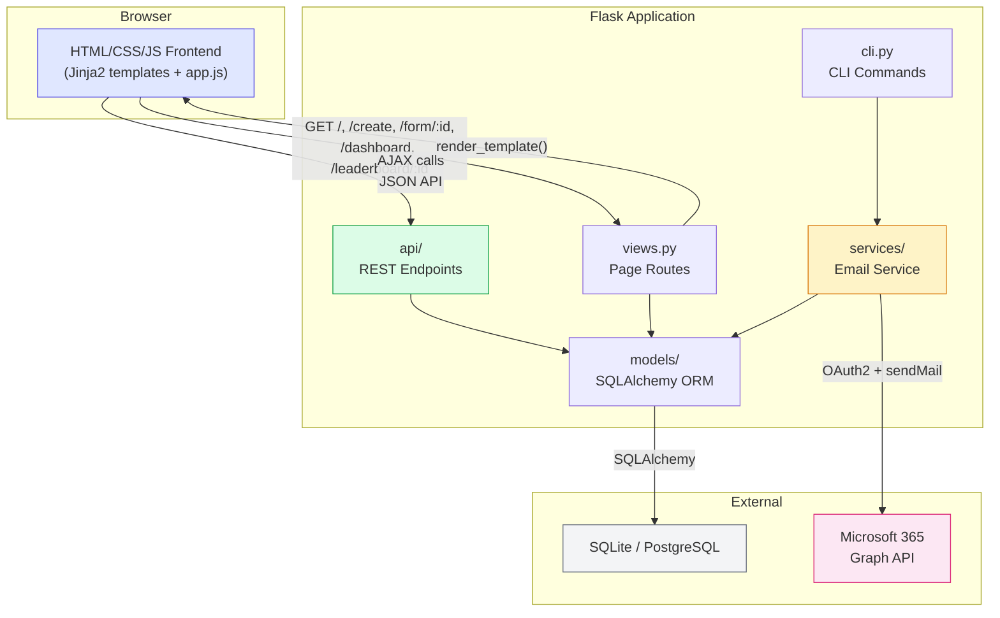
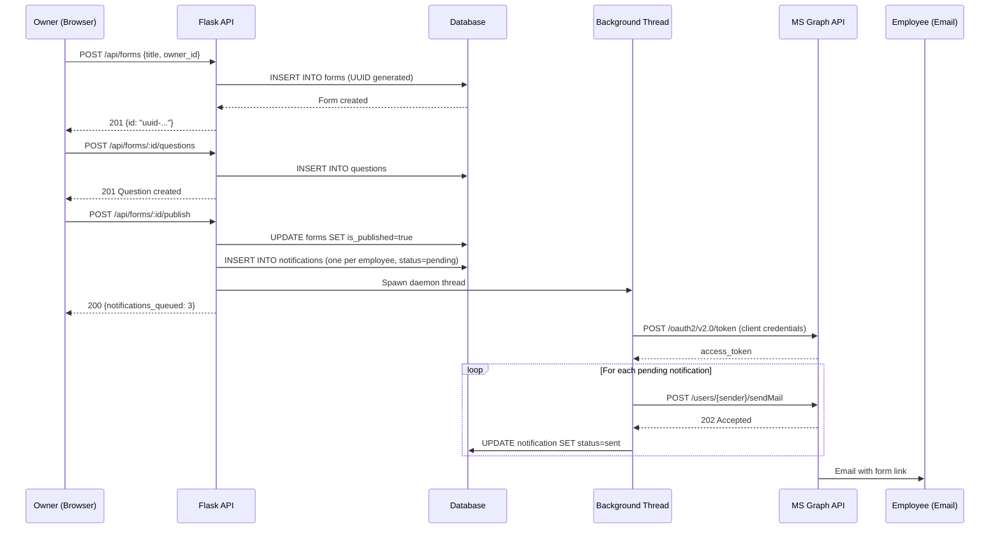
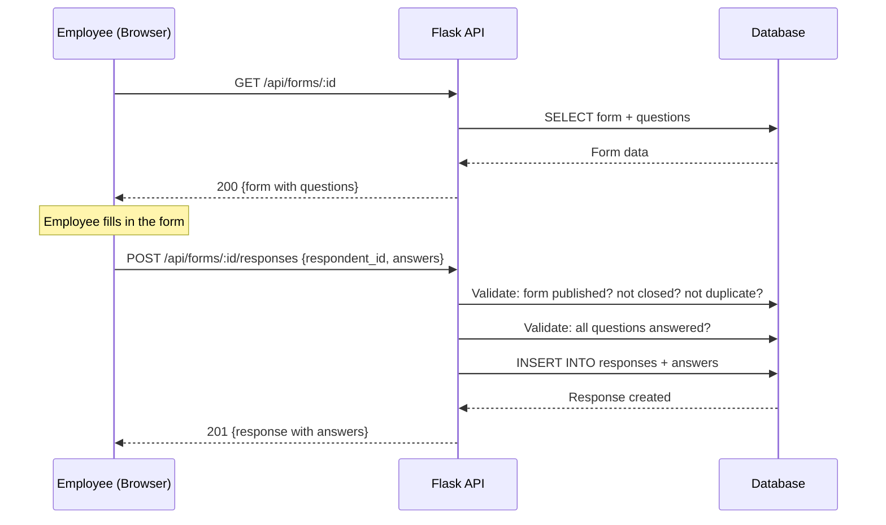
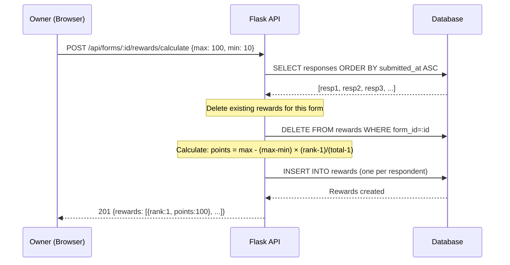
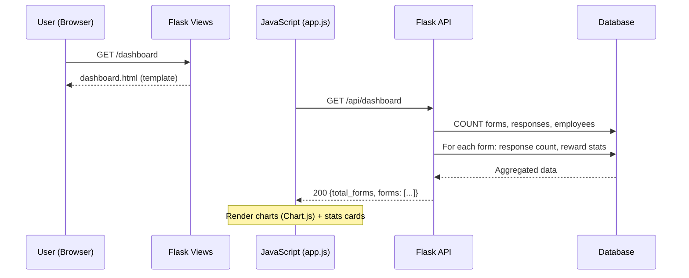
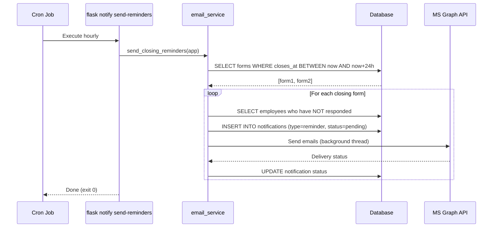

# System Architecture

## Overview

The Feedback platform is a **monolithic Flask application** with a clean
separation between API endpoints, server-rendered pages, and background
services. The frontend uses Jinja2 templates with client-side JavaScript
that calls the JSON API.

---

## Component Diagram



---

## Layer Architecture

```
┌─────────────────────────────────────────────────────┐
│                    Browser                           │
│  HTML templates + CSS + JavaScript (app.js)          │
│  Chart.js for dashboard visualisations               │
├─────────────────────────────────────────────────────┤
│                 Flask Application                    │
│                                                      │
│  ┌──────────────┐  ┌──────────────┐                 │
│  │  views.py    │  │  api/        │  ← HTTP layer   │
│  │  Page routes │  │  REST JSON   │                  │
│  └──────┬───────┘  └──────┬───────┘                 │
│         │                  │                         │
│  ┌──────┴──────────────────┴───────┐                │
│  │         models/                  │  ← ORM layer  │
│  │  User, Form, Question, Response │                │
│  │  Answer, Reward, Notification   │                │
│  └──────────────┬──────────────────┘                │
│                  │                                   │
│  ┌──────────────┴──────────────────┐                │
│  │       services/                  │  ← Service    │
│  │  email_service.py               │    layer       │
│  │  (MS Graph API integration)     │                │
│  └─────────────────────────────────┘                │
│                                                      │
│  ┌─────────────────────────────────┐                │
│  │       cli.py                     │  ← CLI layer  │
│  │  flask notify send-reminders    │                │
│  │  flask notify send-publish      │                │
│  │  flask notify status            │                │
│  └─────────────────────────────────┘                │
├─────────────────────────────────────────────────────┤
│  SQLite (dev) / PostgreSQL (prod)                    │
│  Managed by Flask-Migrate (Alembic)                  │
└─────────────────────────────────────────────────────┘
```

---

## Key Components

### 1. Application Factory (`app/__init__.py`)

The `create_app()` function:
1. Loads configuration by name (`development`, `testing`, `production`)
2. Initialises SQLAlchemy and Flask-Migrate
3. Imports all models (so Alembic can detect them)
4. Registers the API blueprint (`/api` prefix)
5. Registers the views blueprint (page routes)
6. Registers CLI commands (`flask notify ...`)
7. Adds a `/health` endpoint

### 2. API Layer (`app/api/`)

Seven route modules registered under a single Blueprint with `/api` prefix:

| Module | Responsibility |
|---|---|
| `forms.py` | Form CRUD + publish (6 endpoints) |
| `questions.py` | Question CRUD within forms (3 endpoints) |
| `responses.py` | Response submission + listing (2 endpoints) |
| `rewards.py` | Reward calculation + leaderboard (2 endpoints) |
| `dashboard.py` | Aggregate statistics (1 endpoint) |
| `notifications.py` | Notification log queries (2 endpoints) |
| `users.py` | User listing (1 endpoint) |

### 3. Models Layer (`app/models/`)

Seven SQLAlchemy models mapping to database tables. All relationships use
`cascade="all, delete-orphan"` for clean cascading deletes. See
[docs/schema.md](schema.md) for full details.

### 4. Service Layer (`app/services/`)

Currently contains `email_service.py` — the Microsoft 365 Graph API
integration. Handles OAuth2 token acquisition, email composition, and
per-recipient error tracking.

### 5. Frontend (`app/templates/` + `app/static/`)

Server-rendered Jinja2 templates that use client-side JavaScript (`app.js`)
to call the API endpoints via `fetch()`. Chart.js powers the dashboard
visualisations.

### 6. CLI (`app/cli.py`)

Flask CLI commands for scheduled/operational tasks:
- `flask notify send-reminders` — cron-friendly reminder sender
- `flask notify send-publish <id>` — retry/resend publish notifications
- `flask notify status` — notification statistics

---

## Data Flows

### Flow 1: Form Creation → Publish → Email Notification



### Flow 2: Response Submission



### Flow 3: Reward Calculation



### Flow 4: Dashboard View



### Flow 5: Closing Reminder (Cron)



---

## Configuration Architecture

Three configuration classes inherit from a shared `Config` base:

| Class | `FLASK_ENV` | Database | Email | Debug |
|---|---|---|---|---|
| `DevelopmentConfig` | `development` | SQLite (file) | Disabled by default | ✅ |
| `TestingConfig` | `testing` | SQLite (in-memory) | Always disabled | ❌ |
| `ProductionConfig` | `production` | PostgreSQL (via `DATABASE_URL`) | Enabled by default | ❌ |

All sensitive values come from environment variables (see `.env.example`).

---

## Security Considerations

> **Note:** The current version does not implement authentication. User
> identity is passed via `owner_id` / `respondent_id` in request bodies.
> This is suitable for internal/trusted environments. For public deployment,
> add authentication middleware (e.g. Flask-Login, OAuth2, or JWT).

**Current protections:**
- Role-based access: only `owner` users can create forms; only `employee` users can submit responses
- One response per user per form (unique constraint)
- Published forms are immutable (no edits after publish)
- Deadline enforcement (responses rejected after `closes_at`)
- Per-recipient error isolation in email sending
- Background threading for email sends (API never blocks)

---

## Technology Stack

| Layer | Technology | Version |
|---|---|---|
| **Backend** | Python + Flask | 3.10+ / 3.0.3 |
| **ORM** | SQLAlchemy (via Flask-SQLAlchemy) | 3.1.1 |
| **Migrations** | Alembic (via Flask-Migrate) | 4.0.7 |
| **Database** | SQLite (dev) / PostgreSQL (prod) | — |
| **Email** | Microsoft 365 Graph API | v1.0 |
| **HTTP Client** | Requests | 2.32.3 |
| **Frontend** | Jinja2 + vanilla JS + Chart.js | — |
| **Testing** | pytest + pytest-cov | 8.2.2 / 5.0.0 |
